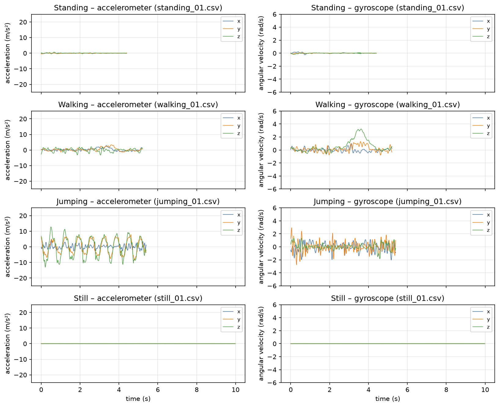
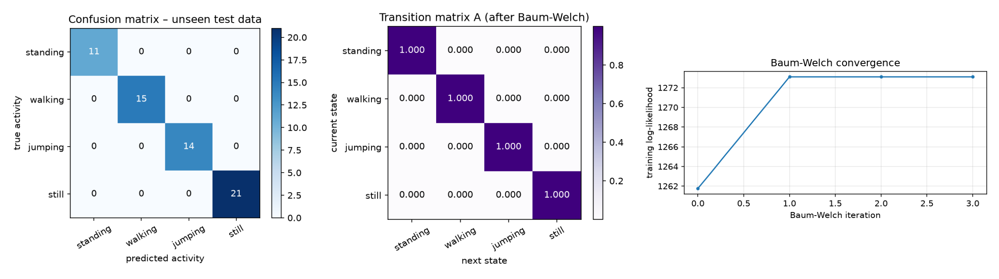
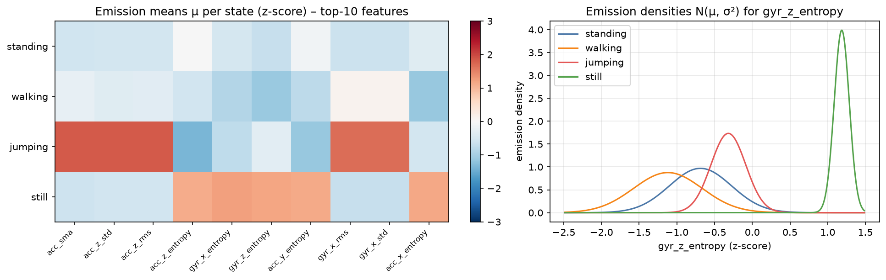
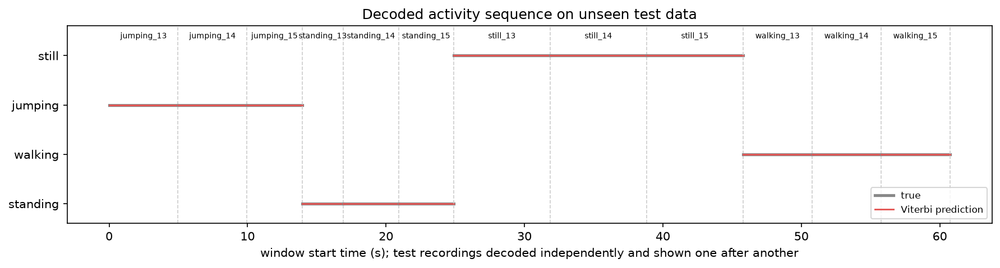

# Modeling Human Activity States Using Hidden Markov Models

**Formative 2 – Individual report** · Author: Amaliza Shalom · 1 November 2026

## 1. Background and Motivation

Phones count steps and active minutes by working out what you're doing from noisy sensor readings. An HMM fits this well: the activity is hidden, the sensors are what we see, and activities carry on over time. I recorded my own accelerometer and gyroscope data for standing, walking, jumping and still, wrote a Gaussian HMM from scratch, and tested it on recordings it had never seen.

## 2. Data Collection and Pre-processing

**Recording.** I used one **iPhone 13** with **Sensor Logger 1.68** over three sessions. Standing, walking and jumping are from 28 and 29 October, with the phone in both hands. *Still* is from 31 October, with the phone flat on a surface as the brief asks. That is my second still batch. The first was hand-held, and Section 5 shows what that cost me.

**Sampling rate.** I set the app to 10 ms and measured **{{fs_mean}} Hz (min {{fs_min}}, max {{fs_max}})** from the timestamps, with no missing, duplicate or out-of-order samples. One phone and one setting gave a uniform rate, so I didn't resample.

**Cleaning.** I used only the calibrated accelerometer and gyroscope, because the uncalibrated accelerometer is in g and includes gravity. I merged them by column name and nearest timestamp (5 ms tolerance).

My standing, walking and jumping recordings are 6.3–9.1 s, so cutting 1.5 s from both ends with a 5 s minimum would keep only 4 of those 45 files. Most of the disturbance was at the start, so I cut 1.0 s from the start and 0.5 s from the end. For standing and still I keep cutting while movement stays above 0.15 m/s². A recording stays if at least 4 s is left, which gives three windows. Six files ended up under 5 s, so I relaxed that guideline. No file was dropped. Five still recordings ran past 10 s, the longest 12.5 s, but all are under 10 s after trimming.

The **unseen test set** is the last three recordings of each activity by start time. Standing, walking and jumping train on 28 October and test on 29 October. Still train and test files are both from 31 October, minutes apart.

{{DATASET_TABLE}}

*Table 1. Cleaned dataset: {{n_files}} recordings ({{n_train_files}} train, {{n_test_files}} test).*

Every activity has over 90 s of raw recording. After cleaning, only still stays above 90 s. The others are 80–87 s.

*Figure 1. One cleaned training recording per activity, with the same y-range per sensor.*

Jumping swings about ±10 m/s² and walking has a smaller step pattern. Standing and still both look flat at this scale, so I expected that pair to be the hard one.

**Windowing.** I used 2 s windows with 50 % overlap ({{win_samples}} samples, {{step_samples}}-sample hop). Two seconds covers 2–3 of my steps and gives a {{bin_hz}} Hz frequency grid. That came to {{n_train_windows}} training and {{n_test_windows}} test windows.

**Videos.** My face is visible in all four. In the jumping video my feet leave the frame when I land. The still video is a separate take from 1 November, not the recording behind the sensor data. It shows me tapping the phone on a shelf and then standing still, and the phone looks small in the frame.

- Standing: {{VIDEO_standing}} (standing.mp4)
- Walking: {{VIDEO_walking}} (walking.mp4)
- Jumping: {{VIDEO_jumping}} (jumping.mp4)
- Still: {{VIDEO_still}} (still.mp4)

## 3. HMM Setup and Implementation

**Features.** Each window gets {{n_features}} features, 22 per sensor:

- **Time domain:** mean, std, RMS and signal magnitude area show how much the phone moves. Axis correlations help because body movement links the axes and noise doesn't.
- **Frequency domain (FFT):** dominant frequency picks up the rhythm of steps and jumps, spectral energy the power of the movement, and spectral entropy whether the signal is periodic or noisy.

{{n_redundant_pairs}} pairs are near duplicates, mostly std and RMS. Gaussian emissions are sensitive to scale, so I z-scored everything using **training windows only**.

**Model.** The hidden states are Z = {standing, walking, jumping, still} and the observations X are the feature vectors. Each emission B is one Gaussian with diagonal covariance and a variance floor of 0.01. I don't have enough data for a full 44 × 44 covariance. **A** holds transitions between consecutive windows and **π** the first state. It is all NumPy, in log space.

**Training.** Each recording is its own sequence, so no transition crosses two recordings. I start the means, variances, A and π from the labelled training windows with add-one smoothing. **Baum-Welch** refines them over {{n_train_files}} sequences and stops when |ΔLL| < 0.0001. It **converged in {{converged_iter}} iterations**, with log-likelihood moving from {{ll_initial}} to {{ll_final}} and never falling. EM doesn't use labels, so I then matched each state to the activity it decodes most on training data. The match was one-to-one.

**Decoding and testing.** **Viterbi** gives the most likely activity path for each recording. The notebook runs **{{tests_total}} automated tests, all passing**, including forward and Viterbi against brute force on a toy model, and checks for test leakage.

## 4. Results and Interpretation

I decoded each of the {{n_test_files}} test recordings ({{n_test_windows}} windows) separately.

{{RESULTS_TABLE}}

*Table 2. Results on unseen data. Overall accuracy is {{test_correct}}/{{n_test_windows}} = {{test_acc_pct}} %. Without Baum-Welch it was {{test_acc_init_pct}} % ({{test_correct_init}}/{{n_test_windows}}).*

*Figure 2. Left: test confusion matrix. Middle: transition matrix A. Right: training log-likelihood.*

Every window is correct. Viterbi keeps each recording in one state, so recordings are the better count: {{n_test_files}} of {{n_test_files}}. The 95 % interval is 94–100 % on windows, but windows from one file aren't independent. On 12 recordings it is 76–100 %, which is the range I'd go with.

In A, every state has a self-transition of {{A_walk}} and every switch sits at the floor. Each recording holds one activity, so A never saw a change. It can't say how people really switch between activities.

*Figure 3. Left: state means of the 10 most discriminative features. Right: emission densities for {{ss_feature}}, the best standing/still separator.*

Jumping is far above the others on intensity, with walking in between. The best feature for separating standing and still is `{{ss_feature}}`, and it makes physical sense. On a surface the gyroscope reads mostly sensor noise, spread across all frequencies, so entropy is high (median 6.0). In a hand, slow sway puts the energy into a few frequencies, so entropy is low (median 2.7).

*Figure 4. Viterbi output (red) and true activity (grey) for each test recording, shown one after another.*

## 5. Discussion and Conclusion

**Easiest and hardest.** Jumping was easiest (acceleration std 3.1–7.1 m/s²), then walking (0.38–0.84 m/s²). Still versus standing was hardest. It is the only pair that ever failed, and the quietest standing file is still only about twice as restless as the noisiest still file.

**Re-recording still.** My first, hand-held still batch scored 84.6 % (44/52). All 8 errors were still windows called standing, and still sensitivity was 0.333. Gravity showed why: the phone was tilted 10–18° for still and 7–13° for standing, nearly the same pose. I replaced all 15 files with the phone flat. Tilt is now 1.9° and the errors are gone. Only the data changed, not the model.

**What the model picked up.** I didn't want to take a perfect score at face value. Acceleration std is 0.005–0.013 m/s² for still and 0.029–0.149 for standing, with no overlap. I then ran the trained model on my 15 old hand-held still files, as a one-off check outside the notebook. All 58 windows came out as standing, even files at 0.017 m/s², quieter than any standing file. So this isn't a simple loudness threshold. The model separates a phone on a surface from a phone in a hand, and it can't tell what the person is doing.

**How far I trust 100 %.** Only partly. Walking, jumping and standing were tested on a different day and held up, even with standing's median std going from 0.034 to 0.106 m/s². Still wasn't: its test files came minutes after its training files, and all still data is from one session. I can't separate the effect of the surface from the effect of the day.

**Baum-Welch.** It converged after {{converged_iter}} iterations and accuracy stayed at {{test_acc_pct}} %. The labelled start already kept the states apart, so EM had nothing to change. On the hand-held data, EM moved 13 still windows into standing and test accuracy fell from 88.5 % to 84.6 %. EM only agrees with my labels when the structure of the data does.

**Sampling rate.** These movements are below about 5 Hz, so 99.45 Hz is more than I need. Still's dominant frequency is 15–19 Hz, which is sensor noise.

**Limitations and improvements.** This is one person, one phone and one room, with 11–21 test windows per activity. Next I would:

1. Record *still* on other surfaces and days.
2. Add a gravity or tilt feature.
3. Record real transitions, so A learns switching.
4. Remove the duplicate features.
5. Test on other people and phone placements.

**Conclusion.** My HMM got {{test_correct}} of {{n_test_windows}} windows and {{n_test_files}} of {{n_test_files}} recordings right on unseen data. The biggest gain came from fixing my data, not the model. This doesn't show it would work on another person or on real changes between activities.
